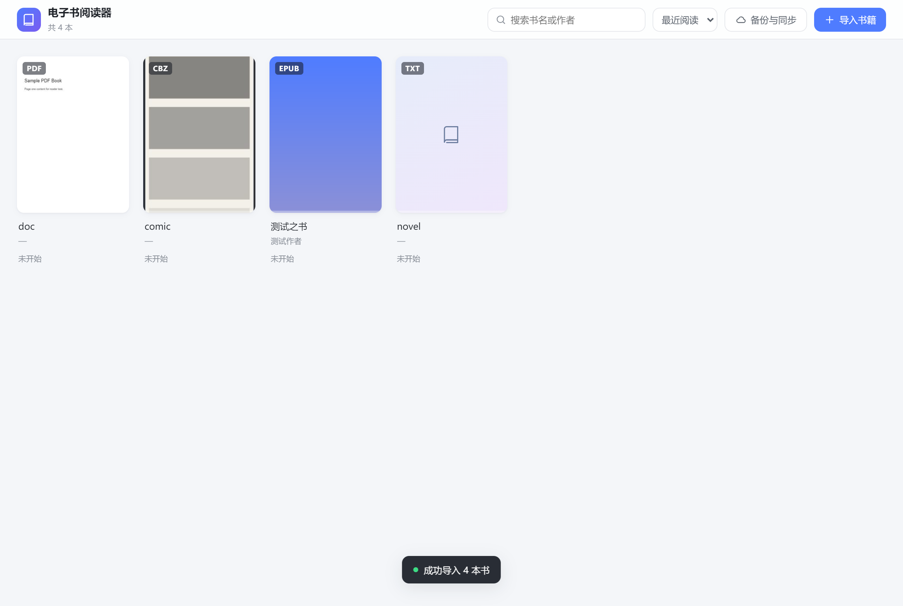

# 电子书阅读器插件（DBX Ebook Reader）

一个面向 DBX 平台（dbxio.com）的电子书阅读器插件：**18 种格式、无格式限制**，内置单页 / 双页 / 滚动三种阅读模式、听书、翻译、高亮笔记与本地 / 网盘备份，界面保持清爽克制。



## 一、功能一览

| 能力 | 说明 |
| --- | --- |
| 多格式解析 | EPUB / EPUB3、PDF、TXT、MOBI、AZW、AZW3、PRC(PDB)、FB2、FBZ、CBZ、CBT、HTML/XHTML/HTM、Markdown、RTF、DOCX、ODT |
| 阅读模式 | 单页、双页（CSS 多栏分页，窄屏自动降级单页）、连续滚动（按章节懒加载） |
| 排版控制 | 字号、行距、页边距、三种字体（衬线 / 黑体 / 楷体）、四种背景（白 / 米黄 / 护眼 / 夜间） |
| 目录与进度 | EPUB 支持 EPUB3 nav 与 EPUB2 NCX 双解析；PDF 支持书签大纲；进度按书持久化，退出重进续读 |
| 听书 | Web Speech API 逐句合成，自动续读下一章，正文跟随高亮，可调语速 / 音调 / 音色 |
| 翻译 | 选中文字即时翻译，支持 OpenAI 兼容接口与 LibreTranslate，结果本地缓存去重计费 |
| 高亮笔记 | 四色高亮 + 批注，侧栏按章节聚合，点击回跳定位，一键导出 Markdown |
| 备份同步 | 导出数据包 / 含书籍文件的完整包，导入恢复；WebDAV 支持坚果云、Nextcloud、群晖 |
| 存储位置 | 四种可选：**本机磁盘（原生后端，路径可改，`library.json` + `books/` 都是真实文件）** / 自动 / 本地文件夹 / 仅本次会话；切换时自动迁移当前书库，界面上直接显示绝对路径 |
| 界面语言 | 简体中文 / English，文案全部走 i18n 资源文件 |
| 数据隐私 | 全部书籍与笔记只存在本机（默认 `<插件数据目录>/library`，可改到任意目录）；无云端同步，API Key、WebDAV 密码仅存本地，不写入备份包 |

其余截图见 `screenshots/`：双页（`05`）、目录（`06`）、设置（`04`）、漫画（`07`）、PDF（`08`）、备份（`09`），以及跟随宿主深色外观的书架与阅读页（`10-shelf-dark.png`、`11-reader-dark.png`）。这些截图由 `npm run shots` 用合成样本重新生成，不含任何真实书籍或个人数据。

## 二、快速开始

```bash
npm install          # 安装依赖
npm run dev          # 本地开发（http://localhost:5173，纯浏览器模式）
npm run build        # 生产构建，输出 ui/（manifest 中 entrypoints.ui.root）
npm run typecheck    # TypeScript 类型检查
npm run pack         # 用官方 CLI 打包，输出 release/*.dbxp + *.artifact.json
```

### 验证（端到端 + 宿主契约）

```bash
node scripts/make-fixtures.mjs                    # 生成 TXT/EPUB/CBZ/PDF 测试样本
npm run build                                     # 必须先构建，预览的是 ui/ 产物
npx vite preview --port 4173                      # 另开终端启动预览
node scripts/e2e.mjs                              # 30 项断言：导入、三种模式、高亮、EPUB、中文 PDF、漫画、编码兼容、备份
node scripts/host-smoke.mjs                       # 11 项断言：宿主深/浅色、语言跟随、无宿主降级
node scripts/screenshots.mjs                      # 生成 icon.png 与 11 张界面截图（含深色）

node scripts/dir-storage.mjs                      # 14 项断言：选择文件夹 → 落盘 → 重载恢复 → 阅读 → 删除清理
node scripts/sidecar-ui.mjs                       # 14 项断言：原生后端落盘、重载仍在、改书库路径（假后端）


# 真实宿主内全流程（需先启动 dbx-plugin dev，见下）
node scripts/host-flow.mjs                        # 12 项断言：沙箱内导入 → 书架 → 阅读 → 存储说明 → 备份导出
node scripts/host-disk.mjs                        # 真实宿主 + 真实磁盘：Node 侧用 fs 逐字节校验落盘结果
node scripts/host-picker.mjs                      # 18 项断言：「选择文件夹」——列目录、快捷位置、新建目录、切换书库
node scripts/host-pdf.mjs                         # 真实宿主内 PDF 渲染：画布墨迹、文本层字符类别、CMap 告警
                                                  # 可指定样本：PDF_FILES=cn.pdf,doc.pdf,real3.pdf

# 原生后端单独验证（不需要宿主）
npm run backend                                   # go build → bin/backend-dev.exe
node scripts/sidecar-check.mjs                    # 36 项断言：JSON-RPC 握手、分块读写、换目录迁移、路径穿越拦截、目录浏览
node scripts/pdf-cmap-check.mjs                   # 中文 PDF 文本提取（含缺 CMap 的对照组）

# 可选：在官方本地宿主中打开（先 npm run build）
npx dbx-plugin dev --path . --port 5190           # 浏览器访问 http://127.0.0.1:5190 后点左侧「电子书阅读器」
```

测试依赖本机已安装的 Playwright Chromium（`%LOCALAPPDATA%\ms-playwright`）。
注意：Playwright 的 `setInputFiles` 注入文件在 change 事件内无法立即读取（CDP 时序限制），因此测试改用 `DataTransfer` 触发 drop，等价于用户拖拽导入。

## 三、目录结构

```
dbx-ebook/
├── manifest.json              # DBX 插件清单（manifest_version: 1）
├── dbx-plugin.toml            # 打包配置（schema_version: 1，含 [backend] Go 侧车声明）
├── backend/                   # 原生 Sidecar（Go，负责真实磁盘 IO）
│   ├── go.mod                 # 无外部依赖，可离线 go build
│   ├── main.go                # JSON-RPC 方法：storage/describe|setRoot|resetRoot|listDirs|mkdir、library/read|write、book/write|read|stat|delete|list
│   ├── fsutil.go              # 目录可写探测、原子写、~ 展开、路径越界校验
│   └── internal/dbxpluginsdk/ # 官方 Go SDK 内联副本（Apache-2.0）
├── assets/plugin.svg          # 插件图标（清单 icon 指向此处）
├── ui/                        # 构建产物 = 插件前端根目录（git 忽略）
├── index.html                 # Vite 模板入口（构建前的源模板）
├── vite.config.ts             # 构建配置（base: './'，outDir: 'ui'）
├── icon.png                   # 商店展示用图标（256×256，由脚本渲染）
├── release/                   # .dbxp 安装包与 .artifact.json
├── scripts/
│   ├── make-fixtures.mjs      # 生成测试电子书
│   ├── e2e.mjs                # 端到端冒烟测试
│   ├── host-smoke.mjs         # 宿主桥接 / 主题 / 语言契约测试
│   ├── host-flow.mjs          # 宿主内全流程测试（沙箱降级存储）
│   ├── dir-storage.mjs        # 本地文件夹存储测试（假 FS 桩）
│   ├── sidecar-check.mjs      # 原生后端协议与落盘校验（spawn 真进程）
│   ├── sidecar-ui.mjs         # 原生后端前端链路测试（假后端，验证重载与改路径）
│   ├── host-disk.mjs          # 真实宿主 + 真实磁盘逐字节校验
│   ├── host-picker.mjs        # 「选择文件夹」宿主内验证（列目录 → 新建 → 切换书库）
│   ├── host-pdf.mjs           # 真实宿主内的 PDF 渲染诊断（墨迹 / 文本层 / CMap 告警）
│   ├── pdf-cmap-check.mjs     # 中文 PDF 文本提取校验
│   ├── gen-pdfjs-assets.mjs   # 生成内联 CMap / 标准字体数据
│   └── screenshots.mjs        # 截图与图标生成
└── src/
    ├── App.vue                # 书架 / 阅读器切换、拖拽导入、全局提示
    ├── main.ts                # bootstrap：载入设置 → 等待宿主 → 挂载
    ├── assets/pdfjs/pdfjs-data.generated.ts  # CMap + 标准字体的 base64 内联数据（自动生成）
    ├── style.css              # 设计令牌（含 html[data-appearance='dark'] 深色令牌）
    ├── i18n/index.ts          # 简中 + 英文案资源
    ├── components/
    │   ├── Shelf.vue          # 书架：导入、检索、排序、删除二次确认
    │   ├── Reader.vue         # 阅读器主视图：调度三种文档、听书、笔记、翻译
    │   ├── SelectionPopover.vue
    │   ├── TranslateDialog.vue
    │   ├── reader/
    │   │   ├── FlowReader.vue # 文字流：单页 / 双页 / 滚动
    │   │   ├── PdfReader.vue  # PDF：画布 + 透明文本层
    │   │   └── ComicReader.vue# 漫画：图集
    │   ├── panels/
    │   │   ├── StorageDialog.vue # 存储位置：本机磁盘（可改路径 / 浏览目录）/ 自动 / 本地文件夹 / 仅本次会话
    │   │   ├── DirPickerDialog.vue # 文件夹选择器（Sidecar 列目录，沙箱里替代系统选择器）
    │   │   ├── TocPanel.vue
    │   │   ├── NotePanel.vue
    │   │   ├── SettingsPanel.vue
    │   │   └── BackupDialog.vue
    │   └── ui/                # 图标、Toast、二次确认对话框
    └── core/
        ├── host.ts            # 宿主桥接（ready / locale / theme / copy / onInit）
        ├── fs.ts              # 本地文件夹访问（File System Access 封装 + 可用性检测）
        ├── sidecar.ts         # 原生后端桥接（invoke 封装 + 分块传输）
        ├── types.ts           # 领域模型
        ├── constants.ts       # 常量（禁止魔法值）
        ├── utils.ts           # 编码识别、HTML 净化、哈希等
        ├── chapterize.ts      # 章节切分（中文章节标题正则）
        ├── render.ts          # Shadow DOM 渲染、高亮锚定、选区偏移
        ├── db.ts              # 存储层（原生磁盘 / 本地文件夹 / IndexedDB / 内存四后端可切换）
        ├── library.ts         # 导入、打开、封面归一化、内存回收
        ├── settings.ts        # 设置持久化 + 宿主默认值套用
        ├── tts.ts             # 听书引擎（逐句队列）
        ├── translate.ts       # 翻译服务（带缓存与超时）
        ├── backup.ts          # 备份导出 / 导入 / 笔记导出
        ├── webdav.ts          # WebDAV 上传下载
        └── parsers/           # 各格式解析器
            ├── index.ts       # 格式识别与分发
            ├── epub.ts        # OPF / spine / nav / ncx / 资源重写
            ├── pdf.ts         # pdf.js 封装
            ├── mobi.ts        # PalmDB + PalmDOC LZ77 + EXTH
            ├── comic.ts       # CBZ(ZIP) / CBT(TAR)
            ├── fb2.ts         # FictionBook XML
            ├── docx.ts        # DOCX + ODT
            ├── html.ts  markdown.ts  rtf.ts  txt.ts
            └── zipUtils.ts    # ZIP 路径解析与 MIME
```

## 四、插件规范符合性

本插件已按 dbxio.com 官方插件规范（plugin-sdk v1）组织，并用官方 CLI 实际打包验证通过。

### 4.1 manifest.json

| 字段 | 取值 | 说明 |
| --- | --- | --- |
| `manifest_version` | `1` | 固定值，标识清单版本 |
| `id` | `com.mjj3610.ebook` | 反向域名式唯一标识 |
| `name` / `version` / `publisher` | `E-book Reader` / `1.2.5` / `mjj3610` | 基础元信息 |
| `engines.host_api` | `1` | 声明使用的宿主 API 版本 |
| `engines.dbx` | `>=0.5.68` | 兼容的 DBX 版本下限 |
| `entrypoints.ui.root` | `ui` | 前端产物根目录 |
| `entrypoints.ui.entry` | `ui/index.html` | 入口页，必须位于 `root` 内 |
| `entrypoints.backend.executable` | `bin/backend` | 原生 Sidecar；打包时 CLI 自动改写为 `bin/<target>/backend.exe` |
| `permissions` | `[]`（空） | 插件页面**不发起**任何网络请求；翻译与 WebDAV 由原生 Sidecar 代发，域名由用户填写，无法预先枚举（详见 §7 网络一栏） |
| `contributions` | `type: workbench` | 注册「电子书阅读器」工作台 |
| `localizations` | `zh-CN` | 中文名称 / 描述，含 contribution 覆盖文案 |

### 4.2 dbx-plugin.toml

```toml
schema_version = 1

[backend]                       # 原生 Sidecar：负责真实磁盘 IO
language = "go"
directory = "backend"
binary = "backend"

[package]
include = ["assets", "ui"]      # 只有这两个目录会进包

[dev]
# ui_build = ["npm", "run", "build"]   # 见下方说明，Windows 下需先手动构建
```

> `[dev] ui_build` 在 Windows 上会失败：CLI 以 `\\?\G:\...` 扩展路径作为 cwd 调用构建命令，`CMD.EXE` 不支持 UNC 前缀，报 `EISDIR: illegal operation on a directory, lstat 'G:'` → `Build failed`。因此这里注释掉该行，用 `dbx-plugin dev` 前先手动 `npm run build`（`ui/` 已存在时 `dev` 可直接服务工作台）。

### 4.3 产物

```text
release/com.mjj3610.ebook-1.2.3-windows-x64.dbxp            # 安装包（非 zip 后缀）
release/com.mjj3610.ebook-1.2.3-windows-x64.artifact.json   # target / url / sha256 / size
```

> 带原生 Sidecar 后不再出 universal 包：CLI 按当前宿主目标构建后端，产物名带 `-windows-x64`
> 之类的 target 后缀。要给其他平台发包，需在对应平台上执行 `npm run pack`。

包内结构（实测）：

```text
assets/plugin.svg
bin/windows-x64/backend.exe      # Go Sidecar（随平台变化）
manifest.json                    # executable 已被 CLI 改写为 bin/windows-x64/backend.exe
ui/index.html
ui/assets/index-*.js  index-*.css
checksums.json
```

### 4.4 宿主桥接

`src/core/host.ts` 统一封装 `window.dbxPlugin`，宿主缺失时全部自动降级：

| 能力 | 行为 |
| --- | --- |
| `ready` | 等待宿主初始化，最长 1200ms，超时按独立模式运行，不会白屏 |
| `theme.appearance` | 写入 `html[data-appearance]`；深色令牌在 `style.css` 中按 `data-appearance='dark'` 与 `data-dbx-theme='dark'` 双选择器匹配 |
| `locale` | 首次运行（无本地设置）时套用宿主语言；用户改过语言后以用户选择为准 |
| `copy` | 复制译文 / 引文优先走宿主剪贴板，沙箱内不可用时降级 `navigator.clipboard` |
| `onInit` | 订阅宿主重建事件，重新套用主题与语言 |

> 未打包、直接在浏览器打开 `ui/index.html` 时不会加载 ES Module（`file://` 被 CORS 拦截），这是浏览器限制而非插件缺陷；本地自测请用 `npm run dev` 或 `vite preview`。

### 4.5 宿主沙箱约束（实测）

用 `dbx-plugin dev` 起真实宿主（`http://127.0.0.1:5190`）后，插件被注入到 `sandbox="allow-scripts"` 的 iframe 中，实测约束如下：

| 约束 | 实测结果 | 插件应对 |
| --- | --- | --- |
| 脚本加载 | CSP `default-src 'none'; script-src 'unsafe-inline' blob:`，宿主只把 `<script src>` 与样式表**内联**进文档 | 构建必须打成**单文件** bundle：关闭 `manualChunks` / `modulePreload` / `cssCodeSplit`，否则分块与预加载全部被拒 → 白屏 |
| PDF worker | 独立的 `pdf.worker.min-*.mjs` 既不能加载（CSP）也不能 fetch（`connect-src 'none'`） | 用 `?raw` 把 worker 源码内联，运行时 `URL.createObjectURL(new Blob(...))` 得到 `blob:` 地址 |
| 主题 | 宿主切换深浅色只更新 `html[data-dbx-theme]`，`dbxPlugin.theme.appearance` 仍是注入时的旧值 | 外观以 `data-dbx-theme` 为准，并用 `MutationObserver` 监听；CSS 同时匹配 `data-appearance` 与 `data-dbx-theme` |
| 存储 | iframe 为**不透明来源**（`origin === 'null'`），`localStorage` 与 `indexedDB` 均抛 `SecurityError`；宿主桥接也**不提供**任何存储 API（只有 `backend.*` / `host.getContext` / `ui.readAsset`） | 三层后端：IndexedDB → **本地文件夹**（用户选目录，真落盘）→ 内存。沙箱中前两者不可用时自动用内存，并提示「本次会话有效」+ 存储位置入口 |
| 目录选择 | `showDirectoryPicker` 存在但被 Chrome 拒绝：`Sandboxed documents aren't allowed to show a file picker` | 系统选择器仍标记为**沙箱限制**并解释原因；真正的「选择文件夹」改由 Sidecar 读盘（`storage/listDirs`）+ 插件自绘选择器实现，不依赖任何浏览器 API |
| 网络 | `connect-src 'none'`：页面里 `fetch` **一律**被拒（实测 `Failed to fetch`，dev 宿主与正式宿主一致），`host.request('host.network')` 在 dev 宿主也未实现 | 把出网整体下移到原生 Sidecar：`net/request` 用用户身份直接联网，页面不再依赖 `host.network` 白名单，自建 OpenAI 兼容接口 / 自建 WebDAV 都能用；`file://` 等非 http(s) 协议被后端拒绝，响应体上限 16 MB |

> 结论：`.dbxp` 能装、能开、能渲染、能读书（实测 `mounted: true`、界面中文、跟随宿主深浅色、导入 TXT 后可翻页阅读）。
>
> **存储降级策略**：四档优先级 **原生磁盘 → 用户选的文件夹 → IndexedDB → 内存**，任一档不可用自动降级，功能不因环境残缺而不可用；界面上的存储位置入口如实显示当前档位与真实路径，不再出现「环境未开放本地存储」这类死胡同提示。
>
> 宿主内的持久化走 Rust/Go sidecar 后端（见 4.6），书库是真的写到用户磁盘上的文件，重载后仍在。

### 4.6 原生 Sidecar（落盘能力）

浏览器沙箱里（`sandbox="allow-scripts"`、`origin === null`）既没有 IndexedDB，
也调不动 `showDirectoryPicker`（Chrome 直接抛 `SecurityError: Sandboxed documents aren't allowed to show a file picker`），
所以纯前端插件无法把书库写进任意磁盘路径。官方给的通道正是 Sidecar：

| 项 | 说明 |
| --- | --- |
| 运行权限 | 与当前用户一致，属于真正的磁盘 IO（不是沙箱） |
| 通信 | 前端 `window.dbxPlugin.invoke(method, params, { timeoutMs })` ↔ 后端 stdin/stdout JSON-RPC v1 |
| 数据目录 | 宿主通过 `DBX_PLUGIN_DATA_DIR` 下发；未提供时回退到用户配置目录（本地调试） |
| 书库布局 | `<root>/library.json`（书单 / 笔记 / 阅读设置）+ `<root>/books/<id>.<ext>`（原文） |
| 大文件 | 按 512KB 分块读写，避免 JSON 消息超限（协议上限 8MB/条） |
| 选目录 | `storage/listDirs` 列盘符 / 快捷位置 / 子目录，`storage/mkdir` 建新目录；沙箱里唯一可行的目录浏览通道 |
| 路径安全 | 文件名只允许纯文件名，`../` 一律拒绝；根目录必须为绝对路径且实测可写 |

前端存储层因此变成四档优先级：**原生磁盘 → 用户选的文件夹 → IndexedDB → 内存**，
任一档不可用都会自动降级并在界面上如实说明。

## 五、实现要点

1. **样式隔离**：书籍自带 CSS 通过 Shadow DOM 注入，不会污染插件 UI；EPUB 的图片 / 字体 / CSS `url()` 统一重写为 `blob:` 地址，离线可读。
2. **分页算法**：用 CSS 多栏（`column-width`）做分页，页数由 `scrollWidth` 反算，双页模式跟随容器宽度自动降级；正文栏宽统一收敛到 `READING_COLUMN_MAX = 820px` 并居中，避免宽屏下行长过长。
3. **高亮锚定**：记录「渲染后文本的字符偏移 + 原文」，重新挂载时先校验锚点，失配则全文回退查找，跨文本节点自动拆分包裹；PDF 文本层用引文定位。
4. **内存控制**：书籍元信息与文件分仓存储，书架列表不加载大文件；解析结果最多缓存 2 本，淘汰时释放 blob URL。
5. **主题跟随宿主**：UI 全部走语义色令牌（`--c-panel` / `--c-subtle` / `--c-hover` …），深色令牌只在 `html[data-appearance='dark']` 下一次覆盖，组件内不出现硬编码 `#fff` / `#f5f7fa`，因此宿主的浅 / 深色切换不需要改任何组件。
6. **存储分层**：`StorageBackend` 接口 + 四个实现（原生磁盘 Sidecar / 本地文件夹 / IndexedDB / 内存）；文件型后端共用一套 `LibraryBackend` + `FileStore` 端口，索引与书籍文件的读写逻辑只有一份。业务层只调 `listBooks`/`putBook` 等 API，切换存储位置时 `snapshot → restore` 自动迁移。
7. **选择文件夹**：沙箱禁用了系统目录选择器，所以目录由 Sidecar 读盘（`storage/listDirs`）、插件自绘选择器（盘符 / 快捷位置 / 面包屑 / 新建文件夹）。后端只返回目录、过滤系统目录与隐藏项，并拒绝含路径分隔符的文件夹名，避免越权建到别处。
8. **PDF 中文不乱码**：中文 PDF 多为 CID 字体 + 预定义 CMap（`UniGB-UCS2-H`、`GBK-EUC-H`…），pdf.js 默认要 `fetch(cMapUrl)` 拉 `.bcmap`，而沙箱是 `connect-src 'none'`，请求必失败 → 整页乱码。现在把 168 个 CMap 与 10 个标准字体以 base64 内联进 bundle，通过自定义 `CMapReaderFactory` / `StandardFontDataFactory` 直接从内存返回字节，全程零网络请求。
9. **文本编码兜底**：`decodeMarkup()` 先看文件头部声明的码表（XML `encoding=` / `<meta charset>` / `@charset`），声明与实际不符时以「能否通过严格 UTF-8 校验」为准；ZIP 内条目名走 `decodeFileName`，避免 GBK 打包的 EPUB 因「OPF 里的 href 与包内文件名解码不一致」导致章节全丢。RTF 按 `\ansicpg` 选码表，MOBI 对「标 1252 实为 GBK」做启发式纠正。
10. **PDF 失败不静默**：单页渲染异常会在该页上显示原因（而不是留一张白纸让人以为「乱码」），整份文档打不开时也有显式提示；加密 PDF 抛 `PasswordException` 时换成「该 PDF 已加密，需要密码才能打开」；元数据标题若是 GBK 字节被按 PDFDocEncoding 解出的乱码（`Âí¼Ì¾¼` 形态），自动退回文件名。
11. **错误兜底**：解析、读文件、翻译、WebDAV 全部有 try-catch，区分业务错误（DRM、不支持的压缩算法）与系统异常，给出可执行提示。

## 六、已知限制

- **AZW3 / MOBI 的 HUFF/CDIC 压缩**：需实现 Huffman 字典解码，当前对这类文件给出明确提示，建议用 Calibre 转 EPUB（PalmDOC 压缩可正常解析）。
- **CBR / CB7**：RAR、7z 为私有压缩算法，纯前端无法解压，已提示转换为 CBZ；`.doc` 二进制格式同理。
- **DRM 电子书**：无法解析，会明确提示。
- **PDF 高亮**：基于文本层引文匹配，扫描版 PDF（无文本层）无法高亮与朗读。
- **扫描版 PDF 搜索**：无文本层时没有可检索文字，需要 OCR（当前不提供）。
- **加密 PDF**：带打开密码的文件无法解析，会提示「该 PDF 已加密，需要密码才能打开」。
- **PDF 非内嵌字体**：字体未内嵌时 pdf.js 会用系统替代字体绘制（控制台会有一条 `Cannot load system font` 提示），字形可能与原版略有差异但不影响阅读；实测本机 8 份真实 PDF（证书、扫描件、5.5MB 大文件）均正常。
- **跨平台发包**：`npm run pack` 只构建当前平台的后端，Windows 包内是 `bin/windows-x64/backend.exe`；macOS / Linux 需各平台各打一次。
- **早期 `.bin` 文件**：1.0.0 版本导入的书籍在磁盘上是 `<id>.bin`（当时元信息晚于文件写入），1.1.0 起为 `<id>.<format>`；已存在的旧文件仍可正常读取，不影响使用。
- **听书音色**：取决于系统 TTS 语音包，桌面端建议安装中文语音。

## 七、上架到 DBX Store

本插件按官方流程提交到 [`t8y2/dbx-store`](https://github.com/t8y2/dbx-store)：**提交的是一个含两个 JSON 文件的 PR，不是 `.dbxp`**；
安装包由商店审核后用仓库密钥签名发布，作者不持有签名私钥，也不要运行 `keygen`。

| 文件 | 作用 |
| --- | --- |
| `LICENSE` | GPL-3.0 全文（商店对新上架插件强制要求许可证） |
| `THIRD-PARTY-NOTICES.md` | 随包分发的第三方组件与许可（pdf.js / JSZip / Vue / DBX Go SDK） |
| `.dbx-store.json` | 商店展示信息：名称、简介、图标、tags、权限、许可、中英文本地化 |
| `.github/workflows/plugin-release.yml` | 发布 Release 时按 5 个平台矩阵构建未签名候选包，复用官方可复用工作流 |
| `scripts/make-store-candidate.mjs` | 读 Release 上的 `release-candidates.json` + `.dbx-store.json`，生成商店要的 `candidates/<id>.json` 与 `publishers/<publisher>.json`，并做一致性校验 |

```bash
npm run pack:ci                                            # CI 里用的打包命令，输出 dist/
npm run store:candidate -- --validate                      # 生成并校验商店候选文件
```

完整步骤（建仓库 → 打 tag 发 Release → CI 出包 → 生成候选 → 提 PR → 审核签名 → 版本更新）见
[`docs/商店上架指南.md`](docs/商店上架指南.md)，其中包含可直接粘贴的 PR 描述模板。
